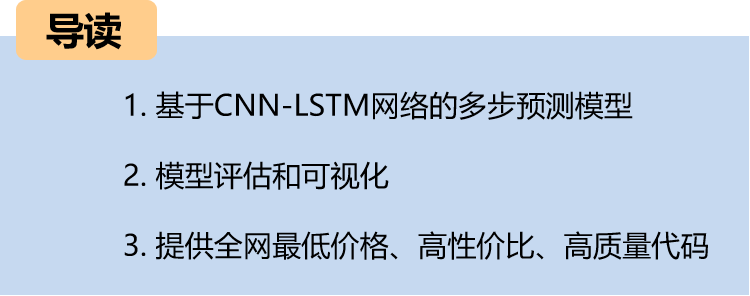
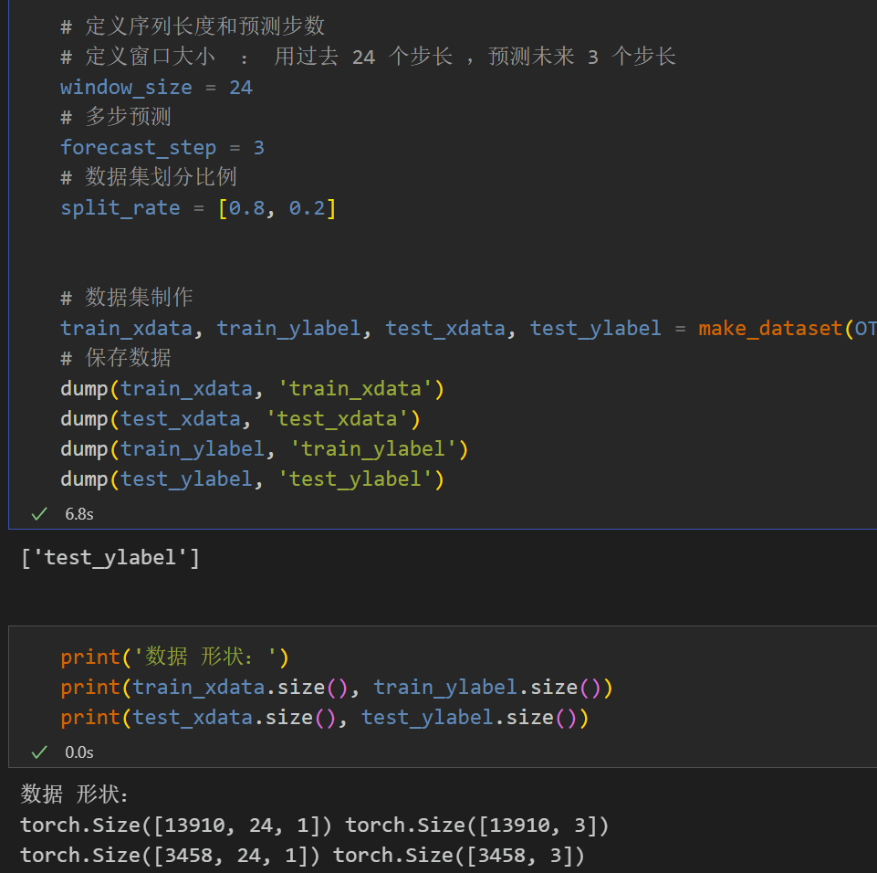
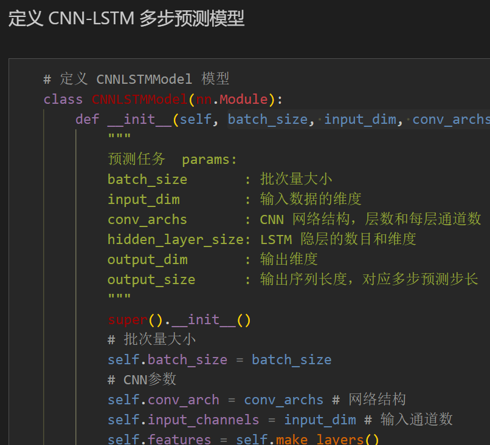
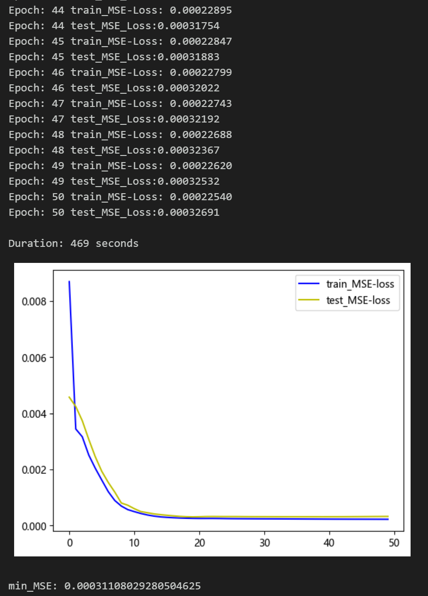
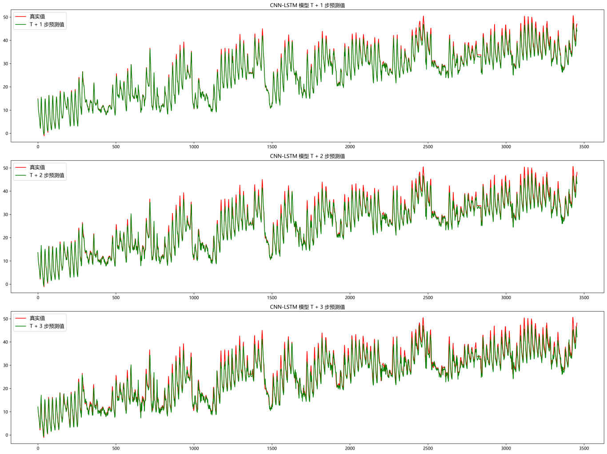
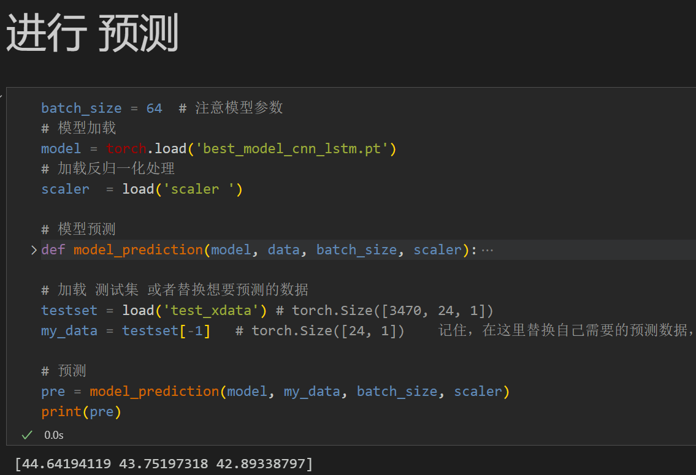
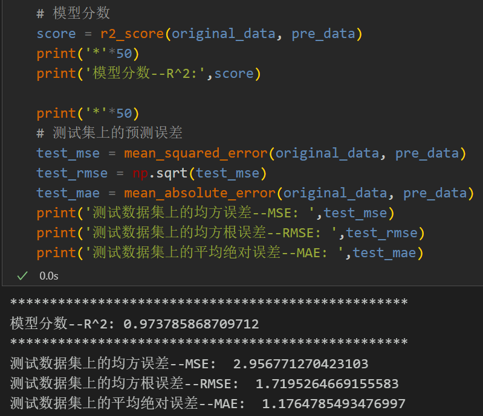
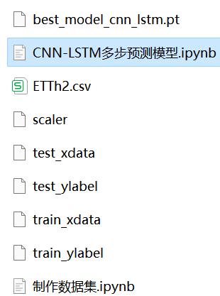

# Multi-step Prediction Model Based on CNN-LSTM Network

Including complete process data code processing:
Multi-step prediction dataset creation, data loading, model definition, parameter setting, model training, model testing, prediction visualization, multi-step prediction, model evaluation. Environment framework: Python 3.9, PyTorch 1.8 and above can be run.
● Usage Object: Paper requirements, graduation design requirements.
● Code Guarantee: The code comments are detailed and ready to run.
Code and file introduction:
Preface
This paper is based on the previous introduction of power transformers (data set attached at the end). It introduces a multi-step prediction model based on CNN-LSTM network.
The detailed introduction to the power transformer dataset can be found in the following text:
Introduction to the Power Transformer Dataset and Preprocessing
1 Data Preprocessing and Visualization of Electric Power Transformers
1.1 Import data
1.2 Multi-step Preprocessing for Prediction
2. Multi-step Prediction Model Based on CNN-LSTM
2.1 Define the CNN-LSTM network model
\t  
2.2 Set parameters and train the model
50 epochs, MSE is 0.000311. The multi-step prediction model of CNN-LSTM has a significant predictive effect. The model can fully extract the spatiotemporal features of sequences, converges quickly, and performs excellently with high accuracy in predictions. By appropriately adjusting the model parameters, further improvements in model predictive performance can be achieved.
\tNote: Adjust parameters.
\tIt is appropriate to increase the number of CNN layers and the number of channels per layer, and fine-tune the learning rate.
Adjust the number of LSTM layers and the number of neurons per layer, increasing more epochs (note to prevent overfitting).
\tThe sliding window length can be changed (set the appropriate window length).
3 Results Visualization and Prediction, Model Evaluation
3.1 Visualization of Prediction Results
3.2 Load the model for prediction
3.3 Model Evaluation
Previously Featured Content:
Time series forecasting: Analysis and comparison of LSTM, ARIMA, Holt-Winters, SARIMA models
Wind speed prediction (I) Data introduction and preprocessing
Wind speed prediction (II) EMD-LSTM model based on PyTorch
Wind speed prediction (III) EMD-LSTM-Attention model
Wind speed prediction (IV) EMD-Transformer model based on PyTorch
Wind speed prediction (V) EMD-CNN-LSTM model based on PyTorch
Wind speed prediction (VI) EMD-CNN-GRU parallel model based on PyTorch
CEEMDAN + combined forecasting model (BiLSTM-Attention + ARIMA)
CEEMDAN + combined forecasting model (CNN-LSTM + ARIMA)
CEEMDAN + combined forecasting model (Transformer - BiLSTM + ARIMA)
CEEMDAN + combined forecasting model (CNN-Transformer + ARIMA)
Multi-feature variable sequence prediction (I) - CNN-LSTM wind speed prediction model
Multi-feature variable sequence prediction (II) - CNN-LSTM-Attention wind speed prediction model
Multi-feature variable sequence prediction (III) - CNN-Transformer wind speed prediction model
Multi-feature variable sequence prediction (IV) Transformer-BiLSTM wind speed prediction model
Multi-feature variable sequence prediction (V) CEEMDAN+CNN-LSTM wind speed prediction model
Multi-feature variable sequence prediction (VI) CEEMDAN+CNN-Transformer wind speed prediction model
Prediction model based on SSA-SSA optimized algorithm for CEEMDAN-BiLSTM-Attention
Predictive Model Based on the Particle Swarm Optimization Algorithm SSA for CEEMDAN-Transformer-BiGRU
Superior Prediction Model: Secondary Decomposition-Combination Prediction
Multi-Feature Variable Sequence Prediction (Part 7) CEEMDAN+Transformer-BiLSTM Prediction Model
Multi-Feature Variable Sequence Prediction (Part 8) Prediction Model Based on Particle Swarm Optimization Algorithm SSA-CEEMDAN-SSA-BiLSTM
Multi-Feature Variable Sequence Prediction (Part 11) Prediction Model Based on Pytorch's TCN-GRU
VMD + CEEMDAN Secondary Decomposition, CNN-LSTM Prediction Model
VMD + CEEMDAN Secondary Decomposition, CNN-Transformer Prediction Model
VMD + CEEMDAN Secondary Decomposition, Transformer-BiGRU Prediction Model
Prediction Model Based on the Particle Swarm Optimization Algorithm SSA - Complete Code Kit
Introduction to Electric Power Transformer Data Set and Preprocessing
 | Sci-Tech 1 Zone High Innovation Prediction Model!
END

## Images

<!-- PAYMENT_BLOCK -->

## Get this dataset

- Payment link (Stripe): [Buy now](https://buy.stripe.com/3cs8yP7sY87d0vu9AB)
- Payment QR code: 

<!-- /PAYMENT_BLOCK -->
